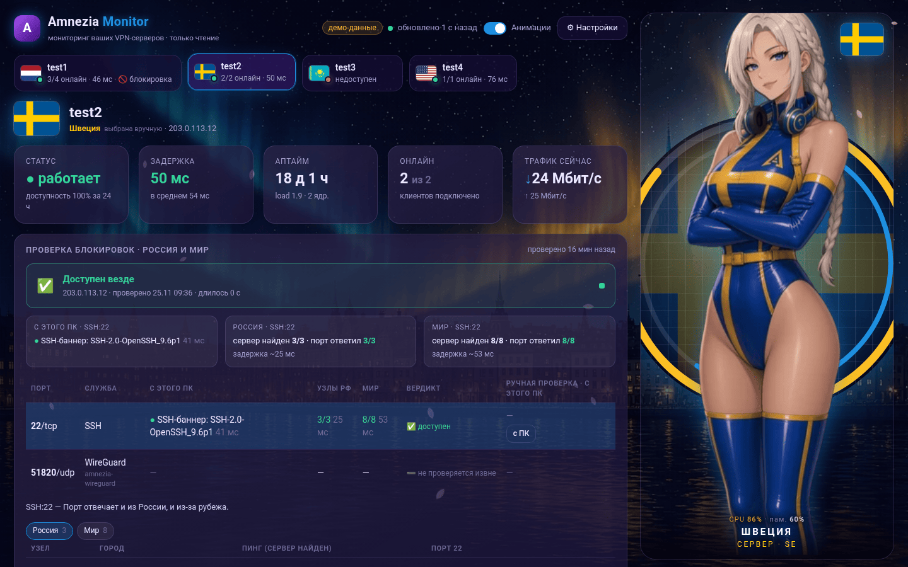

**[Русский](README.md)** · **[English](README.en.md)**

# Amnezia Monitor

Amnezia Monitor shows the state of your AmneziaVPN servers: reachability, load, containers and connected clients. By default the program only reads data. From the app you can enable, check or disable the DNS query log; VPN settings and other services are left unchanged.

Who it is for: anyone who runs one or more of their own AmneziaVPN servers and wants to see them in one window, without logging in over SSH by hand.

Platforms:

- **Windows:** a ready-made app with a dashboard, settings and a tray icon.
- **Android and macOS:** companion apps. They show data from the Windows dashboard on the local network.
- **Linux:** the same agent from source, if the monitor should run continuously, for example on a VPS.

## Download

[](https://github.com/freeon1989/amnezia-monitor/releases/latest/download/AmneziaMonitor-win-x64.zip)
[](https://github.com/freeon1989/amnezia-monitor/releases/latest/download/AmneziaMonitor-android.apk)
[](https://github.com/freeon1989/amnezia-monitor/releases/download/v1.2.0/AmneziaMonitor-macos-v1.2.0.dmg)
[](https://github.com/freeon1989/amnezia-monitor/releases/latest)

### Windows

A ready-made program for 64-bit Windows. Python is not required.

Permanent link to the latest build: [AmneziaMonitor-win-x64.zip](https://github.com/freeon1989/amnezia-monitor/releases/latest/download/AmneziaMonitor-win-x64.zip). A [SHA-256 checksum file](https://github.com/freeon1989/amnezia-monitor/releases/latest/download/AmneziaMonitor-win-x64.zip.sha256) sits next to it. Release file names stay the same.

1. Download the zip.
2. Unpack it into any folder.
3. Run `AmneziaMonitor.exe`.

**SmartScreen.** The file is not signed, so Windows may show “Windows protected your PC”. Click “More info”, then “Run anyway”.

### In-app updates

Settings → Updates. The app checks GitHub Releases and can install a new version.

- Nothing is downloaded or installed until you click the button. There are “Update” and “Skip this version” actions.
- **Windows:** after the download, click “Restart and install”. A helper waits for the program to close, checks that the new exe starts, replaces the file (the previous one stays beside it as `AmneziaMonitor.exe.bak`), launches the new version, and restores the old one if startup fails. Settings and the database in `%APPDATA%\AmneziaMonitor` are not touched. The program folder must be writable (not `Program Files`).
- **Android:** Settings → Updates: check GitHub, changelog, “Update” — the file is downloaded and verified by SHA-256, then you confirm installation in the Android prompt.
- **macOS:** no auto-install; the companion app only reports a new version with a link to the release page.

### Android

File: [AmneziaMonitor-android.apk](https://github.com/freeon1989/amnezia-monitor/releases/latest/download/AmneziaMonitor-android.apk) ([.sha256](https://github.com/freeon1989/amnezia-monitor/releases/latest/download/AmneziaMonitor-android.apk.sha256)). The companion app shows data from the Windows dashboard on the local network. On the PC, enable local-network access and copy the token from Settings. This is a debug build: allow installs from unknown sources. If Android refuses to install the APK over an older build (a different debug signature), uninstall the old version first.

### macOS

Image [AmneziaMonitor-macos-v1.2.0.dmg](https://github.com/freeon1989/amnezia-monitor/releases/download/v1.2.0/AmneziaMonitor-macos-v1.2.0.dmg) or archive [AmneziaMonitor-macos-v1.2.0.zip](https://github.com/freeon1989/amnezia-monitor/releases/download/v1.2.0/AmneziaMonitor-macos-v1.2.0.zip) (with `.sha256` files). Companion app for macOS 13 and newer: a menu-bar icon, the same dashboard data. You need local-network access and the token from the Windows settings. The build is not signed: first launch via right-click → Open.

## Screenshots

Overview:



The full server page, an offline server, settings and the Android companion are in [docs/screenshots/](docs/screenshots/) (see the [Russian README](README.md) for captions).

## Features

- Polls AmneziaVPN servers over SSH, read-only: reachability, CPU, memory, network, containers, clients.
- A dashboard on this computer: status, 24-hour charts, who is online, traffic, events.
- Sites from the DNS log. On the server card there are “Enable DNS log”, “Check” and “Disable” buttons: they configure the log themselves (about 24 hours, 50 MB cap). The Sites section only reads existing Unbound records and archives for the last day.
- “Neon Latex” appearance: a full-height heroine that grows with the window; a soft country flag and load rings behind her (outer arc is CPU, inner is memory). A country-city background, flag colours, an Animations toggle. The same look is used in the Android app. Flags are [flag-icons](https://github.com/lipis/flag-icons) (MIT).
- Block checks: SSH and VPN ports are tested from this PC and from check-host.net nodes in Russia and abroad. The dashboard shows a verdict, “Russia” and “World” tabs, latencies and a “Check now” button.
- Notifications in Telegram or the console, plus an optional daily summary.
- History in a local SQLite database. The program does not change VPN settings.
- Windows: a single `AmneziaMonitor.exe`, a tray icon, a settings page. Passwords are encrypted with DPAPI and are not sent to the browser.

The agent periodically SSHes into each of your AmneziaVPN servers and **only reads** their state. VPN configuration is not changed: peers are not added or removed. The one exception is the DNS-log buttons: they change only the log settings in the `amnezia-dns` container and may restart that container if the config changed. VPN and cascade services are left alone.

## How it works

```
servers.yaml ─► amnezia_monitor.py ── SSH (paramiko, password or key) ─► server 1..N
                     │                    whitelist commands only
                     ├─ parsers: /proc/*, docker ps, awg/wg show all dump, clientsTable
                     ├─ SQLite: polls, containers, peers, events, state
                     ├─ change detector (compared with the previous poll)
                     └─ notifications: Telegram Bot API or the console
```

On each poll, for each server:

1. From the monitoring machine: a TCP connection to the SSH port (latency) and `ping`, if available.
2. Over SSH, read-only: `/proc/uptime`, `/proc/loadavg`, `nproc`, `/proc/meminfo`, two `/proc/stat` readings one second apart (CPU %), `/proc/net/dev` (network rate between polls).
3. `docker ps`: looks for `amnezia-*` containers (awg, wireguard, xray, openvpn, cloak, dns…). For xray, openvpn and other protocols, only running/stopped is shown.
4. For `amnezia-awg` and `amnezia-wireguard`: `awg show all dump` or `wg show all dump`. A client is **online** if the last handshake was less than 180 seconds ago (the threshold is configurable). The server private key in the first dump line is ignored and never stored.
5. Client names come from `/opt/amnezia/<awg|wireguard>/clientsTable` inside the container (where the Amnezia app stores them). The `clients:` config section can override a name by public key.

Any command outside the whitelist (`_ALLOWED_RE`) is rejected before it is sent to the server.

## Passwords and security

- Each server has its own password. A shared password in `defaults` is rejected, and the agent will refuse to start.
- Instead of `password` you can use `password_env: SRV1_PASS` and keep the value in a `.env` file or the environment, so the YAML contains no secrets.
- Prefer a key: `key_path: ~/.ssh/amnezia_monitor`.
- Run `chmod 600 servers.yaml .env`. **Never commit** `servers.yaml` or `.env` — they are already in `.gitignore`.
- Passwords are not written to the log, the database or notifications.
- The host key from the first connection is stored in the program's own `known_hosts` file (`%APPDATA%\AmneziaMonitor\known_hosts` on Windows, `~/.amnezia-monitor/known_hosts` on Linux). `~/.ssh/known_hosts` is only read. A real key change stops the login before the password is sent.

Reading `/proc` works for any user. For `docker ps` and `docker exec` you need root, membership in the `docker` group, or a dedicated `monitor` user with a narrow passwordless sudo rule. `docker exec` can run anything in the container, so for stronger isolation use key-based login and a separate monitoring machine. The agent itself only sends whitelisted commands.

## Linux quick start

```bash
sudo mkdir -p /opt/amnezia-monitor && sudo chown "$USER" /opt/amnezia-monitor
# clone or copy the sources, install requirements, copy servers.yaml.example
# Demo without servers, or a real config — see the Russian README for the full commands
# and systemd units in deploy/
```

systemd units (a persistent process, a one-minute timer, a daily summary and DNS-log cleanup) are in `deploy/`. On Windows the same role is played by `AmneziaMonitor.exe` or `deploy/windows-task.ps1`.

## Dashboard

The dashboard listens on `http://127.0.0.1:8765` by default. On Windows it opens in the app window (WebView2). Settings, the DNS log, block checks and the site list are all in that UI.

## Limitations

- “Online” is based on the handshake. A client with no traffic may still look online for up to 3 minutes after disconnecting.
- For xray, openvpn and cloak, only whether the container is running is shown. Their connections are not counted.
- Network speed appears from the second poll (the first poll is the baseline). CPU % is visible immediately.
- Ping is run from the monitoring machine. If ICMP is blocked, only the TCP delay to SSH is used.
- A TCP port check leaves a harmless `Did not receive identification string` line in the sshd log.
- The `clientsTable` format may change between Amnezia versions. If names are missing, set them in the `clients:` section.

The [Russian README](README.md) has the full file map, systemd units, Telegram setup and build instructions for `AmneziaMonitor.exe`.
