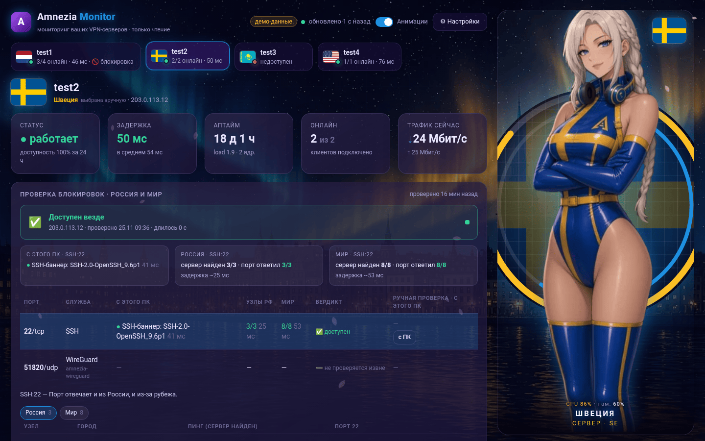
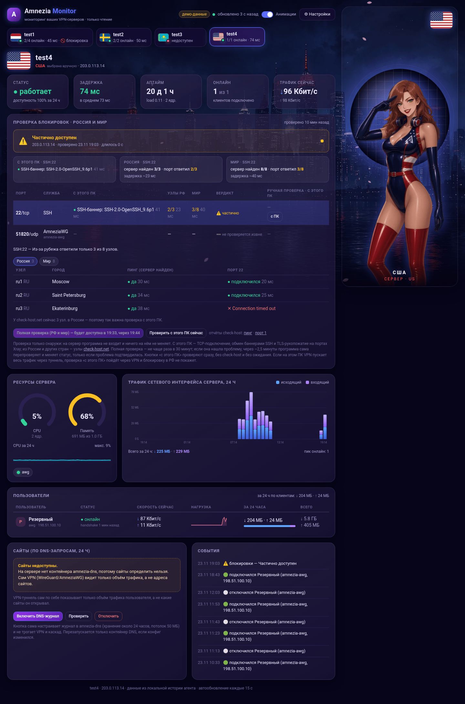
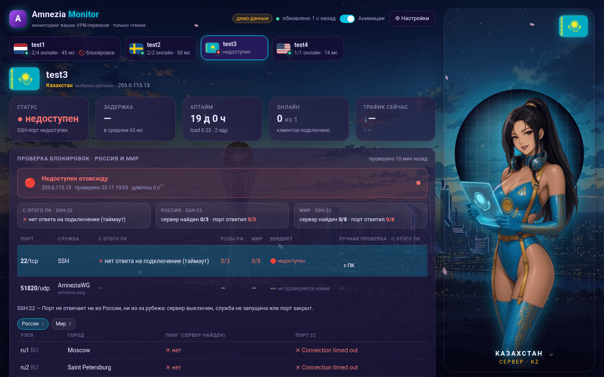
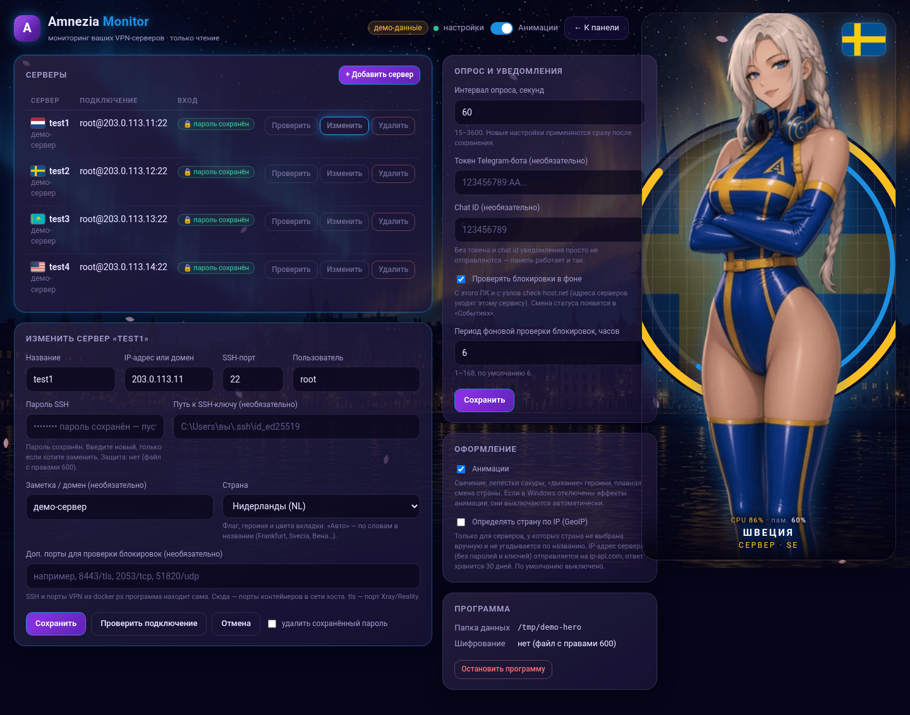
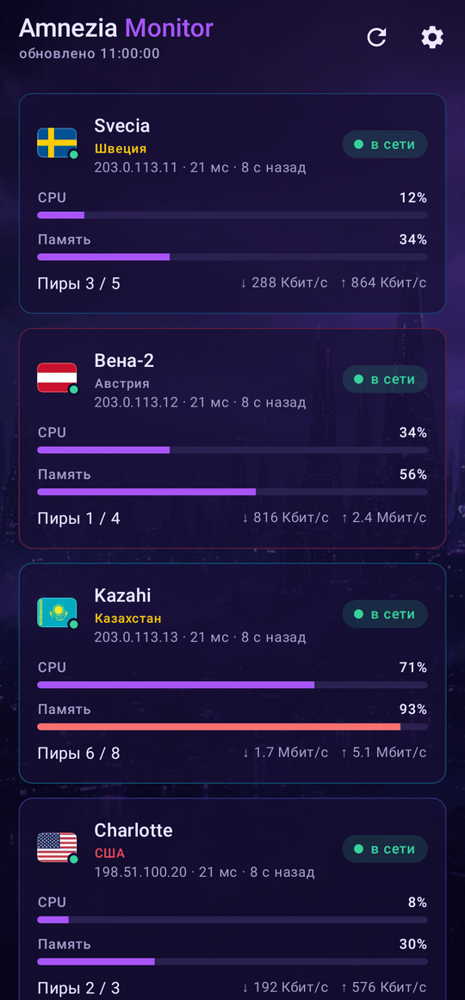
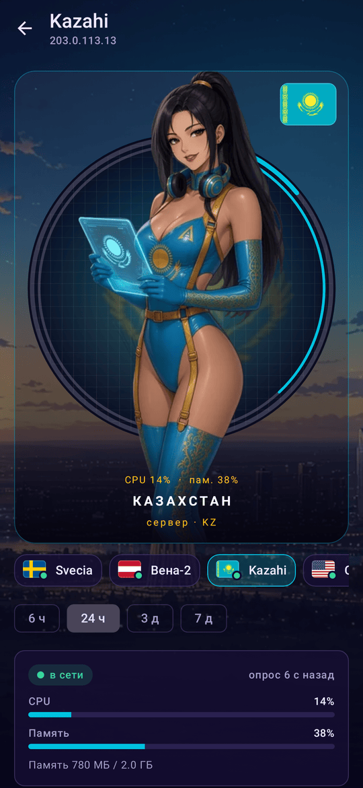

# Amnezia Monitor

Amnezia Monitor показывает состояние ваших серверов AmneziaVPN: доступность, нагрузку, контейнеры и подключённых клиентов. По умолчанию программа только читает данные. Из приложения можно включить, проверить или выключить DNS-журнал; настройки VPN и остальные службы при этом не меняются.

Кому подойдёт: тем, кто держит один или несколько своих серверов AmneziaVPN и хочет видеть их в одном окне, без ручного входа по SSH.

Платформы:

- **Windows:** готовая программа с панелью, настройками и значком в трее.
- **Android и macOS:** приложения-спутники. Они показывают данные панели Windows по локальной сети.
- **Linux:** тот же агент из исходников, если монитор должен работать постоянно, например на VPS.

## Скачать

[](https://github.com/freeon1989/amnezia-monitor/releases/download/v1.4.0/AmneziaMonitor-win-x64-v1.4.0.zip)
[](https://github.com/freeon1989/amnezia-monitor/releases/download/v1.4.0/AmneziaMonitor-android-v1.4.0.apk)
[](https://github.com/freeon1989/amnezia-monitor/releases/download/v1.2.0/AmneziaMonitor-macos-v1.2.0.dmg)
[](https://github.com/freeon1989/amnezia-monitor/releases/latest)

### Windows

Готовая программа для 64-битной Windows. Python ставить не нужно.

Прямая ссылка на текущий архив (v1.4.0): [AmneziaMonitor-win-x64-v1.4.0.zip](https://github.com/freeon1989/amnezia-monitor/releases/download/v1.4.0/AmneziaMonitor-win-x64-v1.4.0.zip). Рядом лежит [файл контрольной суммы .sha256](https://github.com/freeon1989/amnezia-monitor/releases/download/v1.4.0/AmneziaMonitor-win-x64-v1.4.0.zip.sha256).

1. Скачайте zip.
2. Распакуйте архив в любую папку.
3. Запустите `AmneziaMonitor.exe`.

**SmartScreen.** Файл не подписан, поэтому Windows может показать «Windows защитила ваш компьютер». Нажмите «Подробнее», затем «Выполнить в любом случае».

**WebView2.** Окно программы рисуется компонентом Microsoft Edge WebView2. На Windows 10 и 11 он обычно уже установлен. Если окно не открылось, поставьте бесплатный [WebView2 Runtime](https://developer.microsoft.com/microsoft-edge/webview2/) и запустите программу снова. Программа объяснит причину и спросит, открыть ли панель во внешнем браузере: браузер — только запасной вариант и только с вашего согласия.

**Смена ключа сервера.** Если SSH-ключ сервера не совпадает с сохранённым (переустановка системы, пересоздание сервера у хостера — или перехват), вход останавливается до отправки пароля. «Настройки → Проверить подключение» показывает сохранённый и новый отпечатки SHA256 и кнопку «Доверять новому ключу». Сверьте новый отпечаток на самом сервере (`ssh-keygen -lf /etc/ssh/ssh_host_ed25519_key.pub`) и только потом подтверждайте. Ключ заменяется, только если сервер в этот момент показывает тот же отпечаток.

### Android

Файл [AmneziaMonitor-android-v1.4.0.apk](https://github.com/freeon1989/amnezia-monitor/releases/download/v1.4.0/AmneziaMonitor-android-v1.4.0.apk) ([.sha256](https://github.com/freeon1989/amnezia-monitor/releases/download/v1.4.0/AmneziaMonitor-android-v1.4.0.apk.sha256)). В v1.4.0: оформление «Neon Latex» — фон-город страны сервера, флаги на карточках, героиня и цвета страны на экране сервера, переключение серверов флажками, переключатель «Анимации» (подробнее — [android/README.md](android/README.md)). С v1.2.0: смена ключа SSH сервера показывается со старым и новым отпечатками и кнопкой «Доверять новому ключу», «Сайты» читают журнал Amnezia Unbound. Подпись та же, что у v1.2.0 и v1.3.0, — обновление ставится поверх. Если Android не ставит APK поверх старой версии (другая подпись отладочной сборки), удалите старую версию и установите заново. Приложение-спутник: показывает данные панели Windows по локальной сети. На компьютере включите доступ из локальной сети и скопируйте токен в настройках. Это отладочная сборка: разрешите установку из неизвестных источников.

### macOS

Образ [AmneziaMonitor-macos-v1.2.0.dmg](https://github.com/freeon1989/amnezia-monitor/releases/download/v1.2.0/AmneziaMonitor-macos-v1.2.0.dmg) или архив [AmneziaMonitor-macos-v1.2.0.zip](https://github.com/freeon1989/amnezia-monitor/releases/download/v1.2.0/AmneziaMonitor-macos-v1.2.0.zip) (рядом лежат файлы `.sha256`). Приложение-спутник для macOS 13 и новее: значок в строке меню, те же данные панели. Нужны доступ из локальной сети и токен из настроек Windows. Сборка не подписана: первый запуск через правый щелчок и пункт «Открыть». Версия 1.2.0: смена ключа хоста с отпечатками и кнопкой «Доверять новому ключу», журнал Amnezia Unbound. Собирается GitHub Actions (`.github/workflows/build-macos.yml`).

## Скриншоты

Снимки v1.4.0 из встроенного демо-режима (`python app_main.py --demo`) и демо-данных Android: серверы test1–test4, адреса из диапазона документации (203.0.113.x, 198.51.100.x), пароли на экран не выводятся. Настоящих IP, имён клиентов и ключей нет.

### Обзор

Вкладка сервера: флаг, героиня и фон-город страны, проверка блокировок.



### Вся страница сервера



### Сервер недоступен



### Настройки



### Android

<p>



</p>

## Возможности

- Опрос серверов AmneziaVPN по SSH, только чтение: доступность, CPU, память, сеть, контейнеры, клиенты.
- Панель на этом компьютере: статус, графики за 24 часа, кто онлайн, трафик, события.
- Сайты по журналу DNS. В приложении на карточке сервера есть кнопки «Включить DNS-журнал», «Проверить» и «Отключить»: они сами настраивают журнал (около 24 часов, потолок 50 МБ). Раздел «Сайты» только читает уже ведущиеся записи и архивы Unbound за сутки.
- Оформление (v1.4.0): тема «Neon Latex» — флаг страны на вкладке сервера, героиня и цвета в стиле флага, плавная смена при переключении, переключатель «Анимации». Страна: поле «Страна» в настройках сервера > слова в названии > GeoIP (выключен по умолчанию). Фон — город страны с медленным движением и лепестками сакуры. То же оформление есть в Android-приложении (v1.4.0). Флаги — [flag-icons](https://github.com/lipis/flag-icons) (MIT).
- Проверка блокировок (v1.3.0): SSH и порты VPN проверяются с этого ПК и с узлов check-host.net в России и за рубежом. Панель показывает вердикт, вкладки «Россия» и «Мир», задержки и кнопку «Проверить сейчас». Подробности в разделе «Проверка блокировок» ниже.
- Уведомления в Telegram или в консоль и сводка раз в день.
- История в локальной базе SQLite. Настройки VPN программа не меняет.
- Windows: один файл `AmneziaMonitor.exe`, значок в трее, страница настроек. Пароли шифруются DPAPI и в браузер не отдаются.

Агент периодически заходит по SSH на каждый ваш сервер AmneziaVPN и **только читает** его состояние:
доступность, нагрузку (CPU, RAM, сеть, load), контейнеры Amnezia и подключённых клиентов.
История хранится в SQLite. При изменениях (сервер упал или поднялся, контейнер остановился, клиент подключился
или отключился, высокая нагрузка) приходит уведомление в Telegram. Если Telegram не настроен, сообщение
печатается в консоль. Раз в день можно получать сводку.

Конфигурация VPN не меняется: пиры не добавляются и не удаляются. Исключение — кнопки DNS-журнала в приложении: они меняют только настройки журнала в контейнере `amnezia-dns` и могут перезапустить этот контейнер, если конфиг изменился. VPN и службы каскада не трогаются.

## Как устроено

```
servers.yaml ─► amnezia_monitor.py ── SSH (paramiko, пароль или ключ) ─► сервер 1..N
                     │                    только команды из белого списка
                     ├─ парсеры: /proc/*, docker ps, awg/wg show all dump, clientsTable
                     ├─ SQLite: polls, containers, peers, events, state
                     ├─ детектор изменений (сравнение с прошлым опросом)
                     └─ уведомления: Telegram Bot API или консоль
```

Что делается на каждом опросе для каждого сервера:
1. С машины мониторинга: TCP-подключение к SSH-порту (задержка) и `ping`, если он есть.
2. По SSH, только чтение: `cat /proc/uptime`, `cat /proc/loadavg`, `nproc`, `cat /proc/meminfo`,
   `head -1 /proc/stat; sleep 1; head -1 /proc/stat` (CPU % за секунду между двумя чтениями; если второе не пришло — между опросами), `cat /proc/net/dev` (скорость сети между опросами).
3. `docker ps -a --format ...`: поиск контейнеров `amnezia-*` (awg, wireguard, xray, openvpn, cloak, dns…).
   Для xray, openvpn и других протоколов показывается только «работает / остановлен».
4. Для `amnezia-awg` и `amnezia-wireguard`: `docker exec <c> sh -c 'awg show all dump || wg show all dump'`.
   Клиент считается **онлайн**, если последний handshake был меньше 180 секунд назад (порог настраивается).
   Приватный ключ сервера из первой строки dump игнорируется и нигде не сохраняется.
5. Имена клиентов берутся из `/opt/amnezia/<awg|wireguard>/clientsTable` внутри контейнера (там их хранит
   приложение Amnezia). Секция `clients:` в конфиге позволяет переопределить имя по публичному ключу.

Любая команда вне белого списка (регулярное выражение `_ALLOWED_RE`) отклоняется ещё до отправки на сервер.

## Файлы

| Файл | Назначение |
|---|---|
| `amnezia_monitor.py` | CLI и вся логика |
| `demo_data.py` | тестовые данные для `--demo` (в том числе история за 24 ч для панели) |
| `dashboard.py`, `dashboard.html` | веб-панель: HTTP-сервер (stdlib) и одностраничный интерфейс |
| `dashboard_api.py` | JSON API панели: агрегация истории из SQLite |
| `servers.yaml.example` | пример конфига на 4 тестовых сервера |
| `.env.example` | пример переменных: токен Telegram, пароли |
| `requirements.txt` | paramiko, PyYAML, requests |
| `tests/test_monitor.py` | тесты: парсеры, конфиг, демо, SSH-путь (встроенный SSH-сервер paramiko) |
| `tests/test_dashboard.py` | тесты панели: DNS-журнал, агрегация, API, HTTP |
| `deploy/*.service, *.timer` | юниты systemd, включая очистку DNS-журнала |
| `deploy/windows-task.ps1` | задача Планировщика Windows |
| `app_main.py` | режим приложения (`.exe`): мониторинг + панель + настройки, значок в трее, одно окно |
| `app_window.py` | окно Windows на WebView2 |
| `hostkeys.py` | ключи хостов SSH: свой known_hosts, отпечатки, «Доверять новому ключу» |
| `android/`, `macos/` | клиенты для Android и macOS (сборка — `.github/workflows/`) |
| `app_settings.py` | страница «Настройки»: проверка полей, сохранение `servers.yaml`, «Проверить подключение» |
| `dns_setup.py` | включение, проверка и отключение DNS-журнала по SSH из приложения |
| `secrets_store.py` | шифрование паролей: Windows DPAPI (текущий пользователь), иначе файл с правами 600 |
| `AmneziaMonitor.spec`, `build_exe.ps1` | сборка одного файла `AmneziaMonitor.exe` (PyInstaller) |
| `scripts/build_windows.sh` | кросс-сборка Windows-программы на Linux (Wine) |
| `requirements-app.txt` | + pystray, Pillow, pywebview (окно и значок в трее) |
| `tests/test_app.py` | тесты настроек: токен/Origin/Host, пароли не утекают, DPAPI (с подменой), один экземпляр |
| `tests/test_dns_setup.py` | тесты включения DNS-журнала и API `/api/server/dns-log` |

## Быстрый старт на Linux

```bash
sudo mkdir -p /opt/amnezia-monitor && sudo chown "$USER" /opt/amnezia-monitor
cd /opt/amnezia-monitor
unzip ~/amnezia-monitor.zip -d /tmp && cp -r /tmp/amnezia-monitor/. .
python3 -m venv .venv
.venv/bin/pip install -r requirements.txt

# Демо без серверов
.venv/bin/python amnezia_monitor.py --demo check

# Настоящий конфиг
cp servers.yaml.example servers.yaml && chmod 600 servers.yaml
cp .env.example .env && chmod 600 .env
nano servers.yaml        # свои IP, пользователи и пароли (у каждого сервера свой)
.venv/bin/python amnezia_monitor.py -c servers.yaml -v check
.venv/bin/python amnezia_monitor.py -c servers.yaml summary
.venv/bin/python amnezia_monitor.py -c servers.yaml run     # постоянный цикл
.venv/bin/python -m unittest discover -s tests -v            # тесты
```

Команды:
- `check`: один опрос всех серверов, уведомления об изменениях.
- `run`: бесконечный цикл с интервалом `interval`. Если задан `daily_summary_hour`, раз в день отправляется сводка.
- `summary [--hours 24] [--send]`: сводка по истории. С `--send` она уходит в Telegram.
- `--demo` (он же `--dry-run`): встроенные фальшивые данные, без сети и Telegram.

## Пароли и безопасность

- У **каждого сервера свой пароль**: `- {name: test1, host: 203.0.113.11, password: "CHANGE_ME_1"}`.
  Общий пароль в `defaults` запрещён, агент откажется стартовать. Если у двух серверов совпадают пароли,
  в лог пишется предупреждение (без самих паролей).
- Вместо `password` можно указать `password_env: SRV1_PASS`, а значение держать в `.env` рядом с конфигом или
  в окружении (`EnvironmentFile` в systemd). Так в yaml вообще не будет секретов.
- Вместо пароля можно входить по ключу: `key_path: ~/.ssh/amnezia_monitor`. Это надёжнее.
- **Обязательно** выполните `chmod 600 servers.yaml .env`.
- **Никогда не коммитьте** `servers.yaml` и `.env`. Они уже есть в `.gitignore`.
- Пароли не пишутся в лог, в базу и в уведомления. При ошибке входа выводится только тип ошибки,
  например `SSH: AuthenticationException`.
- Ключ хоста при первом подключении запоминается в своём файле `known_hosts` программы (Windows:
  `%APPDATA%\AmneziaMonitor\known_hosts`, Linux: `~/.amnezia-monitor/known_hosts` или `AMNEZIA_KNOWN_HOSTS`).
  `~/.ssh/known_hosts` только читается и не перезаписывается. Тип ключа согласуется с сохранённым, поэтому
  ложной «смены ключа» из-за RSA/ECDSA/ED25519 нет. При настоящей смене вход останавливается до отправки пароля.
  Для строгого режима сначала добавьте хосты сами (`ssh-keyscan`) и задайте `AMNEZIA_STRICT_HOSTKEY=1`.

### Какие права нужны на сервере

Читать `/proc` может любой пользователь. Для `docker ps` и `docker exec` нужен один из вариантов:
- пользователь `root`, как обычно и бывает на серверах, которые настраивало приложение Amnezia;
- пользователь в группе `docker`. Учтите, что эта группа фактически даёт права root;
- отдельный пользователь `monitor` с `docker_cmd: "sudo -n docker"` и узким правилом sudo в
  `/etc/sudoers.d/amnezia-monitor`, например:
  ```
  monitor ALL=(root) NOPASSWD: /usr/bin/docker ps -a --format *, /usr/bin/docker exec amnezia-* sh -c *
  ```
  `docker exec` по своей сути позволяет выполнить в контейнере что угодно. Поэтому для максимальной
  изоляции лучше вход по ключу и отдельная машина мониторинга. Сам агент шлёт только команды из белого списка.

## Telegram

1. Создайте бота у @BotFather и скопируйте токен.
2. Напишите боту любое сообщение. Ваш chat_id можно узнать через
   `https://api.telegram.org/bot<TOKEN>/getUpdates`.
3. В `.env` пропишите `TELEGRAM_BOT_TOKEN=...` и `TELEGRAM_CHAT_ID=...`.

## systemd (постоянная работа)

```bash
sudo useradd -r -s /usr/sbin/nologin -d /opt/amnezia-monitor amnezia-monitor
sudo chown -R amnezia-monitor: /opt/amnezia-monitor
sudo chmod 600 /opt/amnezia-monitor/servers.yaml /opt/amnezia-monitor/.env
sudo cp deploy/*.service deploy/*.timer /etc/systemd/system/
sudo systemctl daemon-reload

# Вариант А: постоянный процесс
sudo systemctl enable --now amnezia-monitor.service
# Вариант Б: таймер раз в минуту (вместо А, не вместе)
# sudo systemctl enable --now amnezia-monitor-check.timer

# Ежедневная сводка в 09:00 (если не используете daily_summary_hour в режиме run)
sudo systemctl enable --now amnezia-monitor-summary.timer

journalctl -u amnezia-monitor -f
```

## На Windows

```powershell
cd C:\amnezia-monitor
py -3 -m venv .venv
.venv\Scripts\pip install -r requirements.txt
copy servers.yaml.example servers.yaml   # заполните; доступ к файлу оставьте только своей учётке
.venv\Scripts\python amnezia_monitor.py --demo check
.venv\Scripts\python amnezia_monitor.py -c servers.yaml check
powershell -ExecutionPolicy Bypass -File deploy\windows-task.ps1   # задачи Планировщика
```

Задача `AmneziaMonitor` запускает `check` каждую минуту, `AmneziaMonitorSummary` присылает сводку в 9:00.
Минус Windows: когда ПК выключен или спит, мониторинга нет. Лучше держать агент на постоянно включённом
Linux, например на маленьком VPS, отдельном от VPN-серверов.

## Веб-панель (дашборд)

Лёгкая страница в браузере: без интернета, без CDN и без дополнительных библиотек (встроенный `http.server` + один HTML-файл). Панель только **читает** локальную базу `amnezia_monitor.db`, которую заполняют `check`/`run`. Сама она к серверам не подключается (если не указан `--with-monitor`).

Что показывает (вкладка на каждый сервер):
- **Шапка-карточки**: статус, задержка (TCP/ping), аптайм и load, сколько клиентов онлайн, текущая скорость сети сервера.
- **Ресурсы**: круговые индикаторы CPU и памяти, график CPU за 24 ч, контейнеры Amnezia (зелёный: работает, красный: остановлен).
- **Трафик интерфейса сервера за 24 ч**: столбики по 30 минут (исходящий и входящий), итоги.
- **Пользователи**: онлайн или офлайн (по handshake), когда был в сети, скорость сейчас (↓ к клиенту, ↑ от клиента), мини-график нагрузки, трафик за 24 ч и за всё время.
- **Сайты (по DNS-запросам)**: топ доменов на сервере и отдельно по каждому пользователю. Работает только если DNS-журнал уже включён (см. ниже).
- **События**: подключения и отключения, падения сервера и контейнеров, высокая нагрузка.

Страница обновляется сама каждые 15 секунд.

### Запуск на Linux
```bash
cd amnezia-monitor && . .venv/bin/activate
python amnezia_monitor.py -c servers.yaml run &          # сбор данных (или systemd-таймер, см. выше)
python amnezia_monitor.py -c servers.yaml dashboard      # открыть http://127.0.0.1:8765
# или всё в одном процессе:
python amnezia_monitor.py -c servers.yaml dashboard --with-monitor
```
Чтобы смотреть панель с другого компьютера, лучше использовать SSH-туннель: `ssh -L 8765:127.0.0.1:8765 user@этот-компьютер`. Вариант `--host 0.0.0.0` откроет панель всем в сети **без пароля**.

### Запуск на Windows
```powershell
cd amnezia-monitor
.venv\Scripts\python amnezia_monitor.py -c servers.yaml dashboard --with-monitor
# затем откройте в браузере http://127.0.0.1:8765
```
Если опрос уже идёт задачей Планировщика (`AmneziaMonitor`), достаточно просто `dashboard`. Автозапуск панели при входе в Windows (без окна консоли, через `pythonw`):
```powershell
powershell -ExecutionPolicy Bypass -File deploy\windows-task.ps1 -Dashboard
```

### Демо и статичная копия
```bash
python amnezia_monitor.py --demo dashboard                    # тестовые данные за 24 ч, http://127.0.0.1:8765
python amnezia_monitor.py --demo dashboard --export-html demo.html
python amnezia_monitor.py -c servers.yaml dashboard --export-html snapshot.html   # снимок ваших данных в один файл
```
Внимание: в снимке `snapshot.html` есть имена клиентов, IP и домены. Не публикуйте его. Паролей в нём нет.

API (JSON): `/api/servers`, `/api/server?name=test1&hours=24`, `/api/health`.

### Сайты пользователей: откуда берутся и как включить
VPN-туннель (WireGuard/AmneziaWG) сам по себе видит только **объём** трафика, но не адреса сайтов. Домены можно узнать только из журнала DNS-запросов контейнера `amnezia-dns`, если клиенты используют его как DNS (в Amnezia это настройка по умолчанию). Если журнала нет, в панели будет надпись «DNS-журнал не включён на сервере».

В приложении (окно Amnezia Monitor) на карточке сервера есть кнопки **«Включить DNS-журнал»**, **«Проверить»** и **«Отключить»**. Они по SSH сами делают настройку: находят контейнер `amnezia-dns`, включают журнал с хранением около 24 часов и потолком 50 МБ, ставят таймер очистки и проверяют, что записи читаются. Действие можно повторять: повторное включение ничего не ломает. Перезапускается только контейнер DNS и только если конфиг изменился; VPN (WireGuard/AmneziaWG) и службы каскада (например `cascade-xray`) не трогаются. Учтите, что это хранение истории посещений ваших пользователей, поэтому предупредите их.

Раздел «Сайты» сам журнал не включает: он только читает активный файл Unbound `/opt/unbound/etc/unbound/unbound.log`, его архивы за сутки и (если есть) журнал контейнера или AdGuard. Можно настроить журнал и вручную:
- **Unbound** (стандартный `amnezia-dns`): в секции `server:` выставить `log-queries: yes` и `logfile: unbound.log` (файл окажется в `/opt/unbound/etc/unbound/` рядом с конфигом). Для хранения суток и ограничения размера поставьте скрипт `deploy/amnezia-dns-log-cleanup.sh` и таймер (каждые 15 минут, 24 часа / 50 МБ), затем перезапустите только `amnezia-dns`. Изменения внутри контейнера могут пропасть, если Amnezia пересоздаст контейнер.
- **AdGuard Home** (если стоит вместо Unbound): «Настройки → Настройки журнала → Включить журнал», либо та же кнопка в приложении. Агент читает `/opt/adguardhome/work/data/querylog.json`.

Ограничения раздела «Сайты»:
- Видны только домены, а не страницы. Многие запросы идут в фоне (обновления, реклама, CDN вроде `googlevideo.com`).
- Если на устройстве включён «Безопасный DNS» или DoH (браузер, Android Private DNS, iCloud Private Relay), запросы мимо `amnezia-dns` не попадут в журнал.
- Привязка к пользователю идёт по туннельному IP (allowed-ips). Если IP в журнале не туннельный (например, из-за NAT в Docker), домен попадёт в статистику сервера под IP-адресом, а не под именем.
- За опрос читаются активный журнал Unbound и его архивы за сутки (и/или querylog AdGuard). При очень большом числе запросов между опросами часть записей может не попасть в выборку.

### Проверка блокировок

На карточке сервера в приложении есть раздел «Проверка блокировок · Россия и мир». Он отвечает на вопрос, открывается ли сервер из России так же, как из-за рубежа. Для этого программа **не входит на сервер и ничего на нём не меняет**: все проверки идут снаружи.

Что проверяется:
- **SSH-порт** сервера и **порты VPN**, которые программа уже видит при обычном опросе: опубликованные порты контейнеров из `docker ps` (Xray/Reality, OpenVPN, AmneziaWG) и `listen-port` интерфейсов AWG/WireGuard. Порты контейнеров в сети хоста, например `cascade-xray`, можно добавить вручную: «Настройки → Изменить → Доп. порты», формат `8443/tls, 2053/tcp, 51820/udp` (`tls` — порт Xray/Reality).
- **С этого ПК** (если он в России): TCP-подключение; на SSH — чтение баннера сервера и обмен версиями (до входа, без пароля); на портах Xray — TLS-рукопожатие (ClientHello).
- **С узлов [check-host.net](https://check-host.net/)**: `check-ping` («сервер найден») и `check-tcp` («порт ответил») с узлов в России и в других странах. Страны с собственной цензурой (Иран, Китай, Беларусь и т. п.) в «мир» не берутся.

Вердикты по каждому порту и по серверу:
- **Доступен везде**: порт отвечает и из России, и из-за рубежа.
- **Признаки блокировки в РФ**: из-за рубежа порт отвечает, а из России нет. Если TCP подключается, а затем обмен обрывается сбросом (RST) или замирает (таймаут), это типичная картина ТСПУ/DPI. Узлы check-host проверяют только подключение, поэтому такой сброс виден лишь с этого ПК.
- **Недоступен отовсюду**: сервер выключен, служба не запущена или порт закрыт.
- **Частично доступен**: результаты расходятся, например из-за рубежа ответила только часть узлов.
- **Не проверяется извне** — UDP (AmneziaWG/WireGuard). Сервер молчит на пакеты без ключа клиента, а check-host проверяет только TCP. Вместо этого показано, сколько клиентов было на связи при последнем опросе.

**Повторная проверка.** Если порт или сервер показал проблему (признаки блокировки, «недоступен», «частично»), результат сразу не сохраняется: карточка показывает «перепроверка…», а через ~2,5 минуты программа сама проверяет плохие порты ещё раз — с этого ПК и, если check-host не на паузе из-за лимита, с его узлов (иначе для сравнения берутся данные из-за рубежа из первой проверки). Статус, событие «Статус изменился» и значок 🚫 меняются, только если проблема подтвердилась («подтверждено повторной проверкой»). Если во второй раз порт в порядке, это записывается как кратковременный сбой. Повторная проверка не сдвигает 30-минутный интервал полной проверки.

**Ручная проверка с этого ПК.** Кнопка «Проверить с этого ПК сейчас» (весь сервер) и «с ПК» в строке порта проверяют сразу, только с этого ПК, без check-host и без 30-минутного ожидания (не чаще раза в 10 секунд). Результат подписан «ручная проверка · с этого ПК» и статус блокировок не меняет.

Полная проверка (с узлами check-host) — не чаще раза в 30 минут: кнопка пишет, во сколько она снова будет доступна. Фоновая проверка по умолчанию идёт раз в 6 часов; её можно выключить или поменять период в «Настройки → Опрос и уведомления». История вердиктов хранится в базе (30 дней), смена статуса появляется в «Событиях».

Ограничения:
- Адреса серверов при проверке уходят публичному сервису check-host.net. Если это нежелательно, выключите фоновую проверку и не нажимайте кнопку.
- У check-host.net немного узлов в России (обычно 3) и есть лимит частоты запросов. Если лимит исчерпан, программа 15 минут не обращается к сервису и проверяет порты только с этого ПК, о чём пишет в карточке.
- Если VPN на этом ПК пускает весь трафик через туннель, проверка «с этого ПК» пойдёт через VPN и блокировку в РФ не покажет.
- Сброс SSH после обмена версиями может дать и защита на самом сервере (fail2ban, `MaxStartups`). Поэтому сверяйте вердикт с результатами из-за рубежа.

## Программа для Windows: один файл AmneziaMonitor.exe

Готовый архив уже собран, ссылка в разделе «Скачать» в начале страницы. Ниже: как устроена программа и как собрать её самостоятельно.

Без установки Python: двойной щелчок по `AmneziaMonitor.exe` запускает мониторинг и панель
и открывает окно программы (`http://127.0.0.1:8765`; если порт занят, выбирается любой свободный).
Значок «A» в трее (возле часов): «Открыть панель», «Папка с данными», «Выход».
Повторный запуск не создаёт вторую копию, а просто открывает панель.

* Настройки и база: `%APPDATA%\AmneziaMonitor\` (`servers.yaml`, `amnezia_monitor.db`, журнал `amnezia-monitor.log`).
* При первом запуске серверов нет, сразу открывается страница **Настройки**: добавьте серверы
  (название, IP или домен, SSH-порт, пользователь, пароль этого сервера или путь к ключу, заметка),
  кнопка **«Проверить подключение»** проверит TCP, вход по SSH и `docker ps` (только чтение).
  Там же интервал опроса и (необязательно) токен и chat id Telegram.
  Изменения применяются сразу, без перезапуска.
  На карточке уже добавленного сервера кнопки **«Включить DNS-журнал»**, **«Проверить»** и **«Отключить»**
  настраивают журнал в `amnezia-dns` и не трогают VPN.
* Пароли и токен хранятся в `servers.yaml` **зашифрованными Windows DPAPI** (`password_enc: dpapi:…`):
  расшифровать их может только ваша учётная запись Windows на этом ПК. В браузер пароли не
  передаются, видно только «пароль сохранён»; пустое поле при изменении = оставить прежний пароль.
  Если перенести `servers.yaml` на другой ПК/учётную запись, пароли придётся ввести заново.
* Панель доступна только с этого компьютера (127.0.0.1). Изменять настройки может только открытая
  программой страница: у неё одноразовый секретный ключ сессии, плюс проверка Origin/Host
  (защита от чужих сайтов в соседней вкладке).
* Остановить: значок в трее → «Выход» или «Настройки» → «Остановить программу».
* Автозапуск: положите ярлык на `.exe` в папку `shell:startup` (Win+R → `shell:startup`).

### Сборка .exe (один раз, на любом Windows-ПК с Python 3.9+)

```powershell
cd путь\к\amnezia-monitor
powershell -ExecutionPolicy Bypass -File .\build_exe.ps1
# ключи: -Clean (пересоздать окружение), -Test (сначала тесты), -Python C:\путь\python.exe
```

Скрипт создаёт `.venv-build`, ставит зависимости и PyInstaller и собирает `dist\AmneziaMonitor.exe`
(около 30-40 МБ: внутри Python, paramiko/cryptography, PyYAML, requests, pystray, Pillow и `dashboard.html`).
Полный путь к файлу печатается в конце. Готовый `.exe` можно копировать куда угодно: он не зависит от папки проекта.

Без сборки то же самое: `python amnezia_monitor.py app` (или `python app_main.py`, демо: `python amnezia_monitor.py --demo app`).

**Особенности .exe:**
* Файл не подписан, поэтому Windows SmartScreen покажет «Windows защитила ваш компьютер».
  Нажмите «Подробнее», затем «Выполнить в любом случае».
* Антивирусы иногда ложно ругаются на однофайловые сборки PyInstaller. Если так, добавьте файл
  в исключения или соберите заново у себя (исходники открыты, сборка воспроизводима).
* Первый запуск занимает несколько секунд: `.exe` распаковывает себя во временную папку.

## Ограничения

- «Онлайн» определяется по handshake. Клиент без трафика может выглядеть онлайн ещё до 3 минут после отключения.
- Для xray, openvpn и cloak видно только, работает ли контейнер. Подключения к ним не считаются.
- Первый опрос служит базой для скорости сети: она появляется со второго опроса. CPU % виден сразу (два чтения `/proc/stat` с паузой в 1 с внутри одной команды).
- Пинг выполняется с машины мониторинга. Если ICMP закрыт, используется только задержка TCP до SSH.
- Проверка TCP-порта оставляет в логе sshd строку вида «Did not receive identification string». Это безвредно.
- Формат `clientsTable` может меняться между версиями Amnezia. Если имена не определились, задайте их
  в секции `clients:`.
